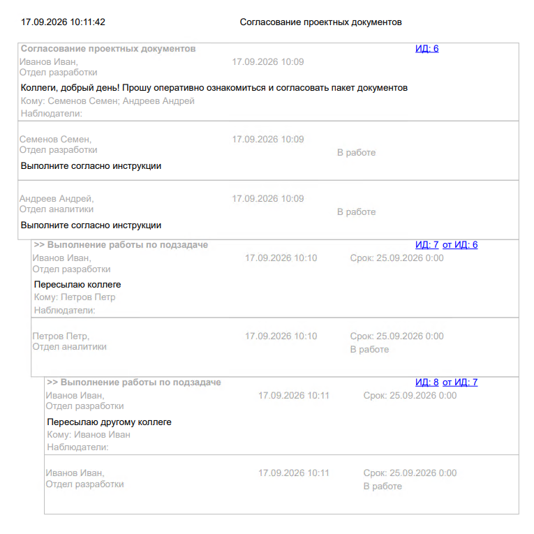

# Иерархический отчет «История переписки по задаче»
Репозиторий с шаблоном разработки «История переписки по задаче».

Шаблон разрабатывался для версии Directum RX 4.12. Совместимость на версиях ранее 4.12 не гарантируется, может потребоваться доработка решения.

## Описание
Шаблон предоставляет возможность сформировать отчет, содержащий переписку в рамках задачи – функциональность, аналогичная действию «Печать переписки». 

Целью реализации шаблона являлось предоставить возможность формирования истории переписки по задаче на стороне сервера, так как на текущий момент действие Directum RX «Печать переписки» вызывается и формирует pdf-файл только на стороне клиента. Шаблон помогает закрыть потребность в передаче переписки по задаче во внешние системы в рамках интеграции, а также служит точкой расширения для вывода дополнительной информации в файл с перепиской по задаче, если у Заказчика есть такая необходимость.

Визуальное представление формируемого отчета упрощено по сравнению с отчетом, формируемым действием «Печать переписки». При необходимости оформление отчета может быть доработано.

Максимальное количество уровней иерархии, предусмотренное шаблоном для визуального отображения, — 10. Если задача содержит подзадачи, расположенные на уровнях иерархии 10 и ниже, они попадут в отчет, однако все будут отображаться как 10-й уровень. Для визуального отображения более 10 уровней иерархии переписки потребуется доработка шаблона.

> [!NOTE]
> Формирование отчета является ресурсоемкой операцией из-за использования вложенных циклов при обработке запусков задач, подзадач и их заданий.
> При большом объеме данных или увеличении максимального уровня иерархии - время его формирования может возрастать.

Шаблон позволяет формировать переписку независимо от типа задачи или задания. Для формирования отчета необходимо передать в шаблон задачу, по которой требуется сформировать переписку:

```
var historyReport = HistoryReport.Reports.GetHierarchyReport();
historyReport.Task = /*задача*/;
historyReport.Open();
```


## Состав решения
1.	Модуль «Отчет с историей переписки» (HistoryReport).
2.	Отчет «История переписки» (HierarchyReport).

> [!NOTE]
> Замечания и пожеланию по развитию шаблона разработки фиксируйте через [Issues](https://github.com/AkelonDev/HierarchyReport/issues).
При оформлении ошибки, опишите сценарий для воспроизведения. Для пожеланий приведите обоснование для описываемых изменений - частоту использования, бизнес-ценность, риски и/или эффект от реализации.
> 
> Внимание! Изменения будут вноситься только в новые версии.
